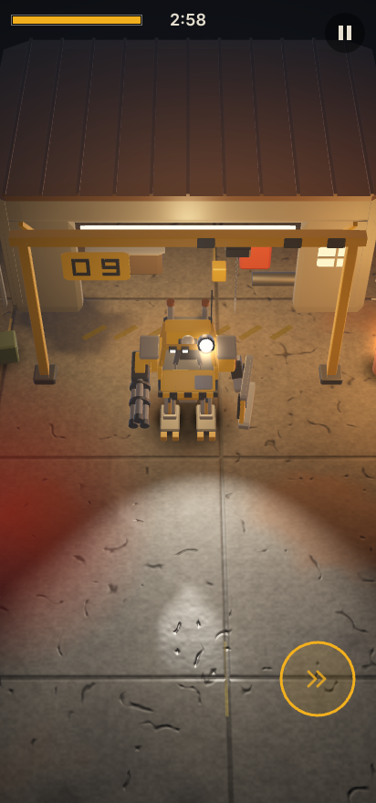
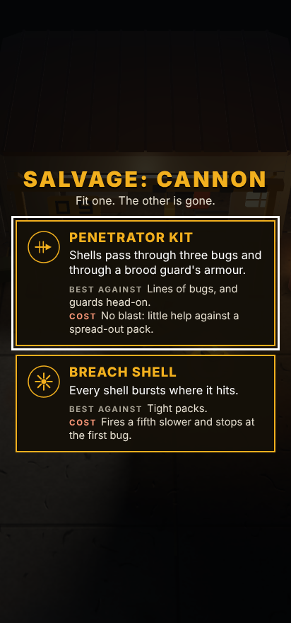
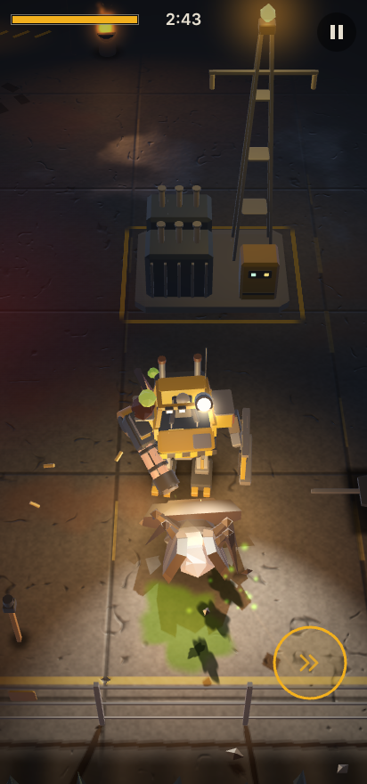
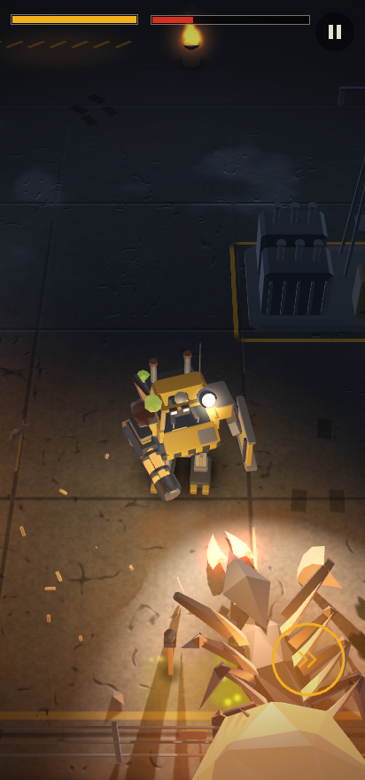

# Last Light

A portrait, one-thumb survivors game in real 3D. You are the mechanic on night shift at **Farm Relay 09**: a fenced machinery yard round a power relay, fields on three sides. You drive a yellow loader walker with a work lamp, a heavy three-barrel cannon and a ram plate. Bugs come up through the concrete along the fence. Hold the yard for three minutes, then kill the brood mother.

Static site, no build step and no libraries: `index.html`, `js/engine.js` (a small WebGL2 renderer) and `js/game.js`. Add `?fps` to the URL for a frame counter and `?seed=7` to repeat a run exactly.

| | | | |
|---|---|---|---|
|  |  |  |  |

This is a single-night vertical slice built to the redesign brief in [`design/redesign-pack/`](design/redesign-pack/MASTER_REDESIGN_BRIEF.md) and the visual kit in [`design/visual-kit/`](design/visual-kit/ART_AND_WORLD_BIBLE.md). What was decided, what was cut and what is still unproven are in [`design/SLICE.md`](design/SLICE.md).

## How it plays

- **Drag anywhere** to walk. The cannon picks its own targets and fires while you move; the torso turns to the target on its own ring while the legs go where your thumb says.
- **Dash** with the button (tap it, or drag it to aim). It is a ram, not a shield: you cannot be hurt during the burst itself, about a quarter of a second, and it comes back after 2.4 seconds. Use it for three things:
  - to get across a red lunge lane or out of a ring;
  - to **ram a brood guard**, which knocks it out of whatever it was doing and leaves it staggered and open;
  - to **ram an open burrow**, which caves it in. Nothing comes out of it for eighteen seconds.
- **Salvage** drops three times a night as a crate with a beam of light over it. Walk onto it when you are ready: the game stops and offers **two modules, of which you fit one**. The other is gone for the run. There are four pairs and three slots, so one role goes unfilled every run.
- **The first brood guard drops a living organ.** It is stronger than hardware and it has a price, which the card states. You can leave it.
- **A red lane on the ground is a lunge about to land.** A red ring is acid about to land; the pool stays for a few seconds. Amber rings are your own mortar shells.
- Only two or three bugs may attack at once. The rest circle and wait.
- Keyboard: WASD or arrows, Space or Shift to dash, 1 / 2 / 3 on a choice, P or Esc to pause, M to mute.

## The night

| Clock | What happens |
|---|---|
| 0:00 | You start under the service gantry at the garage. The klaxon sounds; the first burrow breaks through at the west fence and its warning lamp starts to flash. Lone stalkers. |
| 0:20 | First salvage. Packs begin. A second burrow opens. |
| 1:00 | Second salvage. Spitters arrive. |
| 1:25 | The first brood guard. It drops the organ and a repair cell. |
| 2:00 | Third salvage. Five burrows open. |
| 2:30 | A second guard, then the last push. |
| 3:00 | The brood mother. The floodlights sag, the relay beacon turns red. |

Every 36 seconds runs press, swarm, lull. The number of bugs alive is capped at ten, so a good build means more kills, not a fuller screen. Bug health rises only a little over the night; what changes is which bugs are in the yard together.

## The yard

- **The garage and service gantry** (north-west): where you start, warm light, the 09 plate. The side of the yard nothing comes from.
- **The relay** (middle): two transformers, a mast and a beacon. It is what you are holding, it is the largest piece of cover, and its beacon tells you the state of the night: slow amber while the yard has power, fast red while the mother is in it, dark if you are wrecked.
- **Six burrow sites** along the west, east and south fence. Each has a warning lamp: dark while the ground is whole, flashing while bugs can come up, steady and pale while it is caved in, flashing fast in the three seconds before it breaks open again. The fence is torn where a site has opened.
- Also: the grain silo and its auger, a fuel trailer, a dead walker like yours, three floodlights that sag when a swarm is called, two fire barrels, crop rows outside the fence. The camera stops at the fence.

## Bugs

Each kind has one way of moving, one threat, one tell and one opening.

| | Moves | Threat | Tell | Opening |
|---|---|---|---|---|
| **Stalker** | In packs: straight in, round the side, or circling | A lunge down a lane | Rears, scythes up, red lane for half a second | Step off the lane; a ram or one or two shells kills it |
| **Spitter** | Keeps its distance | Lobbed acid that leaves a pool | Rears, red ring where it will land | Slow and soft; a ram or an arc from the coil breaks its wind-up |
| **Brood guard** | Walks you down | A long charge | Lowers its head, wide red lane | Armoured in front (shells do about a third). Open from the side and behind, and staggered for a second and a half after every charge or when rammed, when it takes more than full damage. The cannon turns to a staggered guard by itself |
| **Brood mother** | Phase one: circles and charges. Phase two: plants herself | Charge and slam; then acid volleys, clutches of stalkers and the slam | Each is marked on the ground first | Armoured in front until she breaks; open for nearly two seconds after each charge. At half health her armour comes off, the sac swells, and she takes more from everything |

## Salvage: ten modules in five pairs

Fit at most three hardware modules and one organ. No rarities and no marks: each module changes how something behaves, and says what it costs.

| Pair | Module | What changes | Best against | Cost |
|---|---|---|---|---|
| Cannon | **Penetrator Kit** | Shells pass through three bugs and through a guard's armour | Lines of bugs, guards head-on | No blast |
| | **Breach Shell** | Every shell bursts where it hits | Tight packs | Fires a fifth slower, stops at the first bug |
| Heavy support | **Shoulder Mortar** | Lobs a shell into the thickest group every three seconds | Groups at a distance | Cannot land within four paces of you |
| | **Arc Coil** | Lightning jumps through four bugs close to you and breaks a spitter's wind-up | Being crowded, spitters | Reaches barely past the ram |
| Dash | **Ram Charger** | The dash goes half as far again; the first ram kill gives half of it back | Breaking out, reaching burrows | A longer commitment |
| | **Burn Exhaust** | The dash leaves a line of fire for three and a half seconds | Cutting off a chase | The dash goes no further |
| Utility | **Lamp Focus** | A tight, hot beam; bugs in it take two fifths more from the cannon | One dangerous target | You see much less to either side |
| | **Reactive Plate** | Stops one hit every ten seconds and throws nearby bugs back | Mistakes, being surrounded | You walk a little slower |
| Alien organ | **Spitter Graft** | A grown limb spits acid at a second target; the pool burns bugs | Holding a lane | The machine is slow to get moving and slow to turn |
| | **Emergency Molt** | Once, the hit that would wreck you sheds a shell: a blast and two fifths of your hull | One bad mistake | After it, the cannon fires at half speed for twelve seconds |

Nothing multiplies everything any more: there is no flat damage, fire-rate or cooldown upgrade, no healing on kills, and each weapon has its own numbers. Repair cells (from guards, and now and then from a kill) are the only way to mend the hull.

**Only an organ grows on the machine.** Hardware stays steel and yellow on its own hardpoint: magazine on the cannon, mortar on the left shoulder, coil on the engine, plate across the chest, hood on the lamp, teeth on the ram, rings on the jets. An organ spreads chitin, cords and sacs over the cannon side. When the mother dies, what was alive falls off; the steel stays.

## What is on screen

During play: the hull bar, the clock, a pause button and the dash ring; the mother's bar when she is there. Salvage or an organ lying off screen has a marker with an arrow at the edge. A swarm or a new breach turns the dark at that edge red for a few seconds. Everything else is in the world.

The end screen says whether the relay held, how long you lasted, kills, burrows closed, and what you fitted.

## How it is drawn and animated

- Everything solid is an instance of one of ten small meshes, lit per pixel. The work lamp is a real spotlight with a shadow map; the garage, the relay beacon, the floodlights, fires, the gun and the thrusters are point lights (six at a time, nearest first).
- The ground is one painted texture; the shader knows where the fence is and draws ploughed soil outside it and a worn painted border inside.
- The whole game runs at nine tenths speed. The lamp is on its own swivel and swings round slowly, so the light does not whip about. The cannon is on its own pivot, so a shell always leaves straight along the barrel. The camera follows your thumb, not the recoil.
- Nothing is keyframed. Feet are planted and step when the body has moved far enough; knees are solved to reach them and bend backward. Lean, recoil, the gun's kick, the ram arm and the antenna are springs. Bugs walk on alternating tripods of legs the same way.
- The 3D view is capped at 1.5 million pixels and drops its resolution, never its frame rate, if the device falls behind.

## Sound

Everything is synthesised in the browser; there are no audio files. The cannon is quieter than it was, so the warnings carry: a screech before a lunge, a wet cough from a spitter, a low horn and the yard klaxon for the mother, a ringing clank when a shell glances off armour, a rumble when a burrow breaks through. Under it runs a bed that follows how much danger you are in: wind, a low drone, a dissonant layer that fades up, and a heartbeat that quickens.

## Accessibility

In **Settings & accessibility** on the title, pause and end screens, saved on the device. Defaults follow `prefers-reduced-motion` and `prefers-contrast`.

- **Motion and flashing:** screen shake, hit-stop, reduce flashing, remains on or off. The gun lights the scene with a steady glow, not a flash per shot.
- **Vision and text:** darkness brightness, high-contrast mode (paler glowing bugs, bolder lunge lanes, thicker bars), text size up to 200%, numbers for hull and dash, and event captions (off by default).
- **Audio and haptics:** master, effects and ambience volume, vibration.
- **Controls:** dash button side and size, fixed or floating joystick, dead zone.
- **Assists:** game speed down to 55%, damage taken, bug speed, number of bugs. Changeable mid-run.
- **Menus:** semantic dialogs, keyboard operable, focus managed, events and pickups announced to screen readers. The title, settings, pause, salvage choice and end screens pass axe-core (WCAG 2.2 AA and best practice) with no violations.

Not done: the action itself is visual and is not playable by screen reader; there is no key remapping; it has not been tested with disabled players.

## Tests

In [`tests/`](tests/README.md): scripted rule checks, bot runs from fixed seeds, and a regression screenshot set at 412×880 and 360×780. `window.advanceTime(ms)`, `window.render_game_to_text()` and `window.setSeed(n)` exist for automated checks.

## Status

**Not playtested.** Everything here was checked in headless Chromium only: by scripted rule checks, by stepping the game and looking at frames, and by bots. It has not been run on a phone, so frame rate on real devices is unknown, and nobody has yet played this version. Whether the choices feel like choices, whether the guard reads as fair, and whether three minutes is the right length are open questions that need people. [`design/SLICE.md`](design/SLICE.md) has the list and a sheet for a first playtest.

The version before the redesign (five nights, nineteen parts) is on the `baseline-pre-redesign` branch. Skills used while designing this are in [`.claude/skills/`](.claude/skills/README.md).

## Earlier versions

- [`flare/`](flare/): the previous 2D build using sprites from the FLARE project (CC-BY-SA 3.0, see [`flare/CREDITS.md`](flare/CREDITS.md)).
- [`legacy/`](legacy/): the first prototype.
