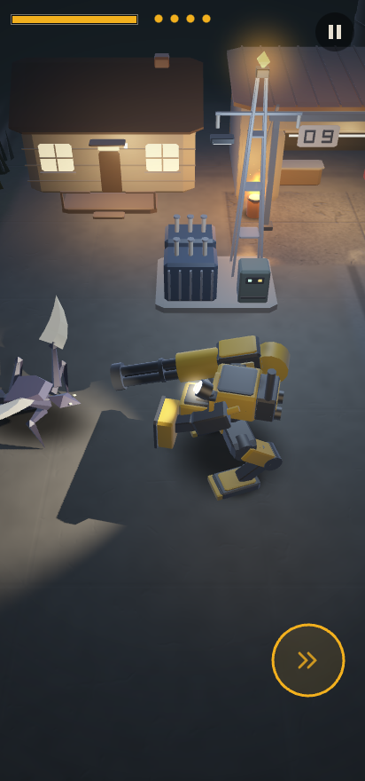
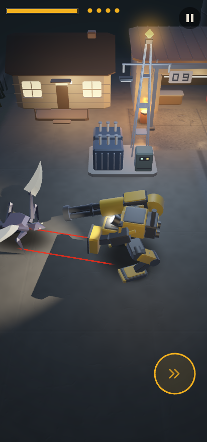

# Last Light

A portrait, one-thumb action game in real 3D. Night on a farm: a house with its lights on, a machine shed, a relay mast. You are the mechanic in an open bucket on the corner of a two-legged loader with a cannon for one arm and a pile-driver for the other. Things with blades longer than their bodies are coming out of the crop.

| | | | |
|---|---|---|---|
|  |  |  |  |

Static site, no build step and no libraries: `index.html`, `js/engine.js` (a small WebGL2 renderer) and `js/game.js`. Add `?fps` to the URL for a frame counter and `?seed=7` to repeat a run.

**This is one encounter, about a minute long, and nothing else.** An earlier and larger version (a three-minute night, four kinds of enemy, ten modules) was cut back to this after a recording showed it still looked and played like a prototype. Why, what was compared, and what was chosen are in [`design/DIRECTION.md`](design/DIRECTION.md). **Nobody has played this version and it has not run on a phone.**

## How it plays

- **Drag anywhere** to walk. The cannon picks its own target and fires: a heavy shell about twice a second. Each one shoves the animal back and twists it; it takes nine.
- **Watch the animal, not the ground.** It circles with its blades folded. When it stops and throws both blades out wide, it is about to pounce, and its line is fixed from that moment: two thin red lines show it for the whole wind-up, nine tenths of a second. Step off the line.
- If it winds up where you cannot see it, off the screen or under a thumb, a **red arc** appears round the walker on the side it is coming from.
- After a pounce its **blades are stuck in the ground** for nearly a second. That is the opening.
- **Ram** with the button. A tap goes at a pinned animal in reach if there is one, otherwise at what the cannon is tracking, and never at something off the screen; a flick on the button goes where you flick. Ram one that is stuck and it is crushed, and if it is in front and 5 to 8.4 m away the ram closes an extra 2 m to reach it. Ram one in its wind-up and it goes over on its back with a blade snapped. Ram one that is just circling and it is thrown and hurt. A ram that hits nothing leaves you sliding with the cannon down. The ram does not protect you: you can be hit at any point in it.
- Four waves: one, two, three, three. Eyes show in the crop before each one walks out, and the dark at that edge of the screen turns red. Only one may attack at a time until the last wave.
- The first kill leaves **salvage**: walk onto it and choose one of two versions of the ram. Ram Charger fits a bigger toothed head and goes further; Burn Exhaust fits twin burners and leaves a wall of fire.
- Keyboard: WASD or arrows, Space or Shift to ram, 1 / 2 on the choice, P or Esc to pause, M to mute.

## The numbers

The one table of what the encounter is tuned to. `SHEAR`, `DASH` and `CAMDEG` in `js/game.js` are the source; `tests/behaviour.js` checks the behaviour.

| | |
|---|---|
| Camera | 30 m, 38° (46° with `?camera=46`), looking 7.5 m ahead |
| Animal | 75% of its first size; 410 health; nine shells |
| Wind-up | 0.9 s, line fixed from its first frame |
| Leap | 0.25 s, 5.5 m, the same at any frame rate |
| What it cuts | the walker's centre, if it is within 1.2 m of the animal's line and between 0.7 m behind the animal and 4 m ahead of it at any point in the leap; one hit per leap, 14 hull (10 with no blades). It stops 3.8 m short of a walker on its line |
| Blades pinned | 0.9 s |
| Rest between attacks | 2.4 to 3.4 s |
| Walker | 6 m/s |
| Ram | 0.08 s wind-up, 0.2 s burst at 31 m/s (6.2 m), 2.4 s cooldown; +2 m onto a pinned animal aimed at |
| Ram on a pinned animal | crushed |
| Ram on a wind-up | on its back 1.8 s, a blade off, 20% health |
| Ram on a roaming or leaping animal | thrown, 35% health |
| Ram that misses | 0.6 s slide, cannon down, full cooldown |

The whole game runs at nine tenths speed (`PACE`), so on the clock every time above is a ninth longer and every speed a tenth lower: the wind-up is 1.0 s, the leap 0.28 s, the walker 5.4 m/s. The measurements below are clock time.

Measured with `node tests/dodge.js`: from a standstill, a sidestep begun up to 0.8 s after the blades rise takes no damage, and one begun up to 0.55 s after leaves daylight between the bodies. Standing still or walking at it is always hit. These are measurements of the rules, not of a person.

## What is on screen

The hull bar, four dots for the waves, a pause button and the ram ring. Everything else is in the world. The end screen says whether the yard was held, how long it took, how many you crushed and how many you shot, and what you fitted.

## How it is drawn

- Everything solid is an instance of one of ten small flat-shaded meshes. The walker was chosen from three blockouts judged as black silhouettes at gameplay scale ([`design/blockouts/mech-silhouettes.png`](design/blockouts/mech-silhouettes.png)) and uses three values only: one body colour, a near-black frame, and the lit bucket.
- The camera is 30 metres out and 38 degrees up, facing north, looking at the ground 7.5 m ahead of the walker so that the walker sits low in the frame, above the thumbs. `?camera=46` uses a steeper angle for comparison. The yard is 44 m by 46 m with the house, shed and silo along its north edge.
- Light: the walker's lamp (a real spotlight with a shadow map; the walker itself is left out of it, because its own body thrown across the ground read as a pit), a cool flood on the relay mast, warm light from the house and the shed, a cool back light so the tops of things have form, and fog that goes to deep teal, never black.
- The ground is one shader: a dirt yard worn pale in the middle, a concrete apron at the shed door, a gravel track with ruts running out through the gate, a grass verge, and ploughed soil with furrows.
- Nothing is keyframed. Feet are planted and step when the body has moved far enough; knees are solved to reach them. Recoil, lean, the ram and the animal's poses are springs and blends driven by the same state the rules use.
- The 3D view is capped at 1.5 million pixels. It drops its resolution a notch when frames have averaged over 21 ms for 2.5 s, raises it a notch when they have held under 17.6 ms for 8 s, and does not retry a level that failed within 12 s of being raised to. If the phone takes the graphics context away the game pauses and rebuilds it when it returns.

## Sound

Everything is synthesised in the browser. Nothing new was made for this version: the animal reuses the old screech, lunge and ricochet. It needs a pass by someone who can hear it.

## Accessibility

In **Settings & accessibility** on the title, pause and end screens, saved on the device. Defaults follow `prefers-reduced-motion` and `prefers-contrast`.

- **Motion and flashing:** screen shake, hit-stop, reduce flashing, remains on or off. The gun lights the scene with a steady glow, not a flash per shot.
- **Vision and text:** darkness brightness, high-contrast mode (paler glowing bugs, bolder lunge lanes, thicker bars), text size up to 200%, numbers for hull and dash, and event captions (off by default).
- **Audio and haptics:** master, effects and ambience volume, vibration.
- **Controls:** dash button side and size, fixed or floating joystick, dead zone.
- **Assists:** game speed down to 55%, damage taken, bug speed, number of bugs. Changeable mid-run.
- **Menus:** semantic dialogs, keyboard operable, focus managed, events and pickups announced to screen readers. The title, settings, pause, salvage choice and end screens pass axe-core (WCAG 2.2 AA and best practice) with no violations.

Not done: the action itself is visual and is not playable by screen reader; there is no key remapping; it has not been tested with disabled players.

## Tests

In [`tests/`](tests/README.md): 30 rule checks, 11 checks on the approved changes, 39 behaviour checks (run at both camera angles), a runner that breaks 19 rules on purpose to confirm the checks notice, a dodge and frame-rate measurement, whole runs by three kinds of bot, and staged frames at 412×880 and 360×780.

## Status

Checked in headless Chromium only, by scripted checks, bots and looking at frames. **Not played by a person, not run on a phone, and no frame rate here means anything about a phone.** The walker and the animal are still the earlier in-game models; the approved designs under [`design/concepts/`](design/concepts/VALIDATION.md) are not built. Stills cannot show weight or timing; one timing bug in this version was invisible in frames and was caught by a check. [`design/DIRECTION.md`](design/DIRECTION.md) lists what is unverified and what to look at first.

Branches: `redesign-slice` is the larger three-minute version this replaced; `baseline-pre-redesign` is the five-night game before that. Skills used while designing are in [`.claude/skills/`](.claude/skills/README.md).

## Earlier versions

- [`flare/`](flare/): the previous 2D build using sprites from the FLARE project (CC-BY-SA 3.0, see [`flare/CREDITS.md`](flare/CREDITS.md)).
- [`legacy/`](legacy/): the first prototype.
